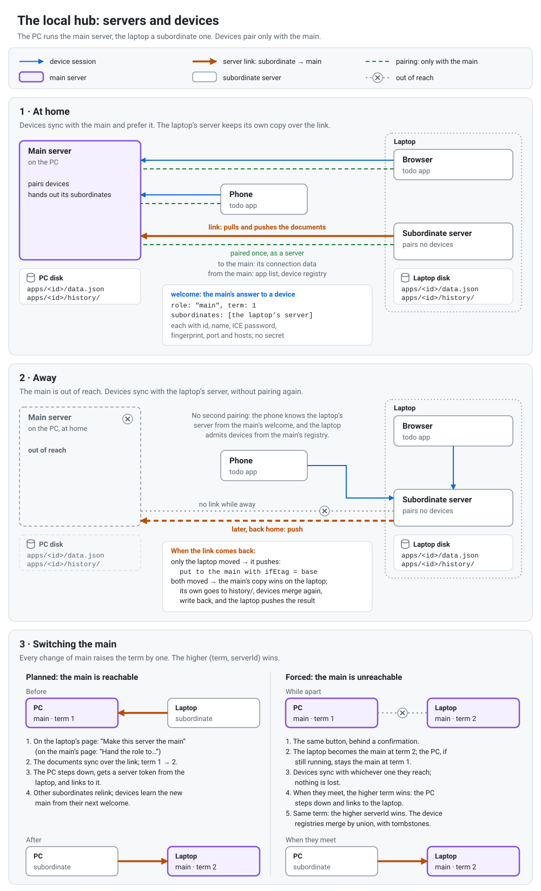

# workspace-server: user guide

[Русская версия](guide.ru.md)

## What it is

`workspace-server` is a small program you run on your own computer. It keeps each app's data as one JSON file in a folder on your disk, and it is the meeting point through which that app's devices (your phone, your laptop) sync with each other.

- **It knows nothing about the apps' data.** It stores what an app sends, checks only that it is JSON, and tells versions apart by their hash. There is no database and no schema.
- **It works over your local network.** Devices connect to it over WebRTC. After a one-time pairing, a device connects by itself whenever its app is open.
- **It needs no outside services.** There is no domain, no certificate to install, no account and no internet connection involved.

The first app that uses it is the todo app.

## Why it exists

A web app keeps its data in the browser, and the browser does not promise to keep it:

- clearing site data deletes it;
- the browser may evict it when space runs low;
- Safari deletes it after seven days without a visit.

`workspace-server` keeps a copy on your own disk, as a plain file you can read, back up and edit. It also carries changes between your devices, so the phone and the laptop see the same data.

## What it is not

- **Not the source of truth.** Each app keeps its own copy and treats the server as one more participant: the one with a disk that is always on. An app keeps working when the computer is off or the phone is away from home, and it catches up later.
- **Not a merge tool.** When two devices change the same data, the apps resolve it themselves. The server only refuses a write based on an out-of-date version.
- **Not reachable from outside your network,** and it has no user accounts. It is for one person's devices on one local network.

## What you need

- A computer that stays on while you want to sync: macOS, Windows or Linux. The server has **never been tested on Linux**; see [Known limits](#known-limits).
- Your devices on the **same local network** as that computer.
- An app that supports it, such as the todo app.

## Installing

Download the file for your system from [GitHub Releases](https://github.com/FLighter7/workspace-server/releases):

| System | File |
| --- | --- |
| macOS, Apple silicon | `wss-mac-arm64` |
| macOS, Intel | `wss-mac-amd64` |
| Windows | `wss-windows-amd64.exe` |
| Linux, x86-64 | `wss-linux-amd64` |
| Linux, ARM64 | `wss-linux-arm64` |

`SHA256SUMS` in the same release lists the checksums. The program is one file. There is no installer, and nothing else to install.

1. **Pick a permanent folder** for the file, not Downloads. The autostart (below) remembers where the file is.
2. **Rename the file** to `workspace-server`, or to `workspace-server.exe` on Windows. This guide uses that name.
3. **On macOS and Linux, make it executable.** In a terminal, in that folder (use the name of the file you downloaded):

   ```
   mv wss-mac-arm64 workspace-server
   chmod +x workspace-server
   ```

### The first run

The file is not code-signed, so the system asks for confirmation once:

- **macOS (Gatekeeper):**
  - On macOS 15 and later: run the file once and let it be blocked. Then open System Settings → Privacy & Security, scroll to the message about `workspace-server`, and press "Open Anyway".
  - On older macOS: Control-click the file and choose Open.
  - From Terminal, `xattr -d com.apple.quarantine workspace-server` removes the quarantine mark.
- **Windows (SmartScreen):** press "More info", then "Run anyway".
- **The firewall** asks once whether to allow incoming connections. Allow them; on Windows, tick **Private** networks. Devices connect to the server, so without this they cannot reach it.
  - On macOS the question comes back after each update, because the file changes.

## Running

**Open the program file:** double-click it, or run `./workspace-server` (macOS, Linux) or `.\workspace-server.exe` (Windows) in a terminal from its folder.

- A window with the server's log opens, and the browser opens the server's web page, `http://localhost:47800/` by default.
- On macOS, a double click in Finder opens the file in Terminal.
- **If the server is already running,** no second one starts: the browser opens the running server's page, and the second program ends at once. On macOS, Terminal keeps its window open with the message `workspace-server is already running`; close it, or set Terminal → Settings → Profiles → Shell → "When the shell exits" to close the window.
- **To stop it,** press Ctrl+C in its window, or close the window.

On the first start the server creates its folder and an entry for the `todo` app, so the todo app can pair right away.

## Running in the background and at login

```
./workspace-server start      # macOS, Linux
./workspace-server stop
./workspace-server delete
.\workspace-server.exe start  # Windows
```

- **`start`** runs the server in the background, makes it start every time you log in, and opens the web page. No window stays open.
  - It registers a LaunchAgent on macOS, a logon task for your user on Windows (no administrator rights needed), or a `systemd --user` service on Linux.
  - On Windows it also lists the program in Settings → Apps.
  - If a server is already running, `start` restarts it, so that a new file you just put in place is the one that runs.
- **`stop`** stops the server and stops it starting at login. Nothing is deleted: run `start`, or open the file, to start it again.
- **`delete`** removes the server from the computer; see "Removing it".
- **The file path:** `start` remembers where the file is. If you move the file, run `start` again from the new place.
- **On Windows,** a console window may flash briefly at login.
- **After a crash,** the system starts the server again. After `stop`, or the page's Stop button, it stays stopped.

## The web page

`http://localhost:47800/` opens only on this computer; other devices cannot reach it. It starts in the browser's language (English, Russian or Polish) and the system's light or dark theme; the two buttons at the top right change them, and the browser remembers the choice. It has three sections:

- **Server** (Сервер):
  - shows the name devices see, the computer's addresses, the server's `.local` name and whether it is published, and the two ports; a warning under the addresses means devices cannot connect at the moment (the reason is in `server.log`), and the server keeps trying;
  - you can change the name and the ports here;
  - **Data folder** (Папка данных): where the apps' data is kept; see "Where your data lives";
  - **Upstream server** (Связь с главным сервером): links this server to a main one, as a laptop's server is linked to the PC's; see "A laptop as a second server";
  - **Manage the server** (Управление сервером): three buttons, each of which asks first:
    - **Stop the server** stops it and stops it starting at login, like `stop`. Your data is kept.
    - **Delete data** starts the server over as if it were new: every app's documents and versions, the list of apps and the paired devices are deleted, and every device must pair again. The name, the ports and the data folder are kept. The question lists each app's data and lets you download it first.
    - **Delete the server and all data** stops the server and removes it from the computer, like `delete`: its data, its folders, the program file and the autostart.
- **Devices** (Устройства):
  - **Pair a device** at the top opens the pairing code; on a server linked to a main, devices pair with the main instead;
  - lists, for each app, its paired devices: when each paired, when it was last seen, and whether it is connected now; servers linked to this one are listed first, under **Linked servers**;
  - **Remove** disconnects a device and ends its access.
- **Apps** (Приложения):
  - lists each app with its document size, last change, number of saved versions and number of devices;
  - here you add an app, or delete one together with its data and devices. Deleting shows exactly what goes, offers to download the current document first, and asks you to type the app's id.

## Pairing a device

1. On the web page, open **Devices** and press **Pair a device**. It shows a pairing code as a QR code and as text with a Copy button.
2. In the app on your device, open its sync settings, and scan the QR code or paste the text.
3. The device connects and is paired. From now on it syncs by itself whenever the app is open and the server is reachable.

**About the code:**

- A code works for **one device** and for **10 minutes**. "New code" makes a fresh one and cancels the old one.
- There is no "confirm" button: having the code proves you were at the server's screen.
- The code contains no password for later. The device gets its own access key during pairing, and the server keeps only a hash of it.

If a device asks for an app the server does not serve yet, the page offers to add that app with one click. Then pair again.

## A laptop as a second server



The PC runs the main server, and a laptop can run a second one that keeps a copy of every app's data on its own disk. At home your devices sync with the PC; away from home they sync with the laptop's server without pairing again, and the two servers exchange the changes when the laptop is back.

### Setting up the laptop

1. Install workspace-server on the laptop as on any computer (see "Installing"), and open its page.
2. Get a pairing code from the main server: on the PC's page, **Devices** → **Pair a device**, or from a phone paired with it (in todo: Sync → Pair another device).
3. On the laptop's page, open **Server** and find **Upstream server**. Paste the code and press **Link**, or press **Scan with the camera** and hold the QR code up to the laptop's camera.
4. The laptop's server is now linked to the main: it takes the main's apps, copies their data, and shows the link's state.

Linking deletes nothing. If both servers already hold an app's data, the main's copy wins on the laptop, the laptop's copy is kept among its saved versions, and the devices merge the two. A server that other servers are linked to cannot be linked to another main itself.

### Pairing the laptop's browser

Devices pair only with the main, the laptop's own browser too. On the laptop's page, press **Pair this computer's browser** (under Devices, or under Server → Upstream server). The laptop asks the main for a pairing code and shows it as a QR code and as text with a Copy button; paste it into the app's sync settings in the browser. This needs the main to be reachable. As with any new code, the one on the main's page stops working.

### At home and away

- **At home** the devices sync with the main, and the laptop's server keeps its copy in step with the main's.
- **Away**, with the main out of reach, devices paired with the main sync with the laptop's server instead, without pairing again: the main told them about it. The laptop keeps the changes.
- **Back home**, the laptop sends the main what changed. If both sides changed, the main's copy wins on the laptop, the laptop's goes to its saved versions, and the devices merge the two, as they always do.
- A device paired while the laptop could not reach the main syncs with the laptop only after the two have met again.

### Keeping an eye on it

- The laptop's **Upstream server** shows the main, whether it is connected, when it was linked, the last sync and the apps synced. If an app writes to the main too often within a minute, it stops syncing with the main, to protect the saved versions on both servers; the section lists it, and its devices still sync with the laptop. Press **Resume** beside it to sync it with the main again at once; a restart of the laptop's server resumes it too. If the app keeps writing that often, it stops again.
- The main's **Devices** lists the laptop's server under **Linked servers**, with its addresses. **Remove** there stops it syncing with the main; its data stays on the laptop.
- **Unlink** on the laptop's page makes it a main again. Nothing is deleted on either side, and the main's devices no longer sync through the laptop. If the main cannot be reached at that moment, the page says so: remove the laptop on the main's page later.

### Making the laptop the main

The laptop's server can take the main's role over: when the laptop becomes the computer you rely on, or when the PC breaks. Devices then pair with the laptop, and the PC's server, if it is still there, syncs through the laptop as the laptop used to through the PC. No device pairs again, and nothing is deleted.

- **While the PC is reachable:** on the laptop's page, open **Server** → **Upstream server** and press **Make this server the main**, or on the PC's page, open **Devices** → **Linked servers** and press **Make it the main** on the laptop's card. Confirm. The two servers first make their data the same, then the PC's server hands its role over and links to the laptop's; any other server linked to the PC follows by itself.
- **While the PC cannot be reached** (switched off, away, broken): press **Make this server the main** on the laptop's page. The page asks again and says what happens next:
  - the laptop's server becomes the main at once;
  - if the PC's server still runs, both act as the main until they meet again; devices sync with whichever one they reach, and nothing is lost;
  - when the two meet, the one made the main later wins: the PC's server steps down by itself and syncs through the laptop's, its own changes merged in by the devices.
- **If the PC is gone for good,** the laptop's page lists it among the servers it waits for. Once you know it will not come back, remove it under **Devices** on the laptop's page.
- **Devices** keep working throughout: a device paired with the PC finds the laptop's server as the main and from then on treats it as the server it is paired with.

## Updating

1. Put the new file in place of the old one, with the same name in the same folder. On Windows, run `stop` first: a running program file cannot be replaced there.
2. Run `start`. It restarts the server on the new file.

Your data, settings and pairings are kept, and devices do not need to pair again. On macOS, confirm the Gatekeeper and firewall questions again.

## Removing it

Run `delete`, or press **Delete the server and all data** on the web page, or, on Windows, uninstall "workspace-server" in Settings → Apps.

- It shows what goes, including the path of the program file, and asks `Delete all of this? [y/N]`. Only `y` deletes; Enter keeps everything.
- It stops the server, stops it starting at login, and deletes the server's folder, the apps' data, and the program file.
- If you chose your own data folder, only the server's data in it is deleted. The folder itself goes only if nothing else is left in it.
- **This deletes the server's copy of every app's data and all pairings.**
  - The devices keep their own copies; turn sync off in each app.
  - Download a document from the Apps page first if you want to keep it.
- `delete --yes` deletes without asking.
- **Left behind:**
  - Firewall entries. Windows keeps the rule created on the first run; removing it needs administrator rights: Windows Security → Firewall & network protection → Allow an app through firewall. On macOS the entry is in System Settings → Network → Firewall → Options.
  - On Windows, if you delete the program file by hand, its entry in Settings → Apps stays. Windows does not clean it up.

## Where your data lives

The server keeps its settings and identity in its **server folder**:

| System | Server folder |
| --- | --- |
| macOS | `~/Library/Application Support/workspace-server` |
| Windows | `%APPDATA%\workspace-server` |
| Linux | `$XDG_DATA_HOME/workspace-server`, by default `~/.local/share/workspace-server` |

```
config.json            name, ports and the data folder
identity.json          the server's identity; if it is lost, every device pairs again
apps.json              the apps this server serves
devices.json           paired devices
upstream.json          the link to the main server, on a server linked to one
family.json            on a server that took the main's role over
server.log             the log; it never grows past 1 MiB
server.lock            keeps a second server off this folder
```

The apps' data is in the **data folder**, which is the server folder unless you choose another one:

```
apps/<id>/data.json    the app's current data
apps/<id>/history/     previous versions (10 by default)
```

- **Choosing the data folder:** on the web page, under Server → Data folder, type or paste the path of a folder and press Change.
  - A folder that does not exist yet is created.
  - If there is data now, the page tells you it will be moved there, and the server restarts. Devices stay paired.
  - If the new folder already holds a server's data and the current one holds none, the page offers to use that data, and adds its apps to the list.
  - If both hold data, the change is refused.
  - If the folder is on a disk that is not connected when the server starts, the server does not start. `server.log` in the server folder says why.
- **Each app's data** is stored exactly as the app sent it, as a plain JSON file.
  - Before a change replaces it, the old version moves to `history/`.
  - The largest document accepted is 64 MiB by default; you can change it per app.
- **Writes are atomic:** a crash or power loss leaves either the old file or the new one, never half of one.
- **`apps.json`** can be edited by hand while the server runs. The change takes effect within a few seconds.
- **Backing up and moving:** to back up, copy the folders. To move the server to another computer, copy the server folder (and the data folder, if it is another one) there; every pairing keeps working. A data folder you chose is remembered by its full path: on the new computer, put it at the same path before you start the server. If it is not there, the server either does not start or starts with no data.
- **One server per folder:** two servers cannot use one server folder at the same time.

To run a second, separate server, or one on other ports for one run:

```
./workspace-server run -dir <folder> -udp-port <n> -http-port <n>
```

`stop -dir <folder>` and `delete -dir <folder>` act on such a server only; they leave the autostart and the program file alone.

## Ports and network

- **UDP 47801** is for devices: they connect here.
  - Changing it means **every device must pair again**, because devices remember it. The page warns you.
- **HTTP 47800** is for the web page, on this computer only.
  - You can change it freely; the page moves to the new port.
- **Address changes are picked up by themselves.** The server checks the computer's addresses every 30 seconds. On a change, devices reconnect by themselves.
- **VPNs:** a VPN on the computer does not get in the way of devices on the local network.

## Troubleshooting

- **A device cannot connect:**
  - Check that the device and the computer are on the same network. A guest network with "client isolation" blocks devices from each other.
  - Check that the firewall allows `workspace-server` (on Windows, for **Private** networks).
  - Check that the server is running: the web page opens.
  - `server.log` in the server folder says which addresses the server listens on.
- **"another workspace-server is already using …":** a server is already running on that folder, but not on the port in its settings. Stop it, or open its page at the port you gave it.
- **The window closes at once:** a server is probably running already, and its page opened in the browser. Otherwise run the file from a terminal to see the message.
- **The pairing code expired:** press "New code".
- **The app says the server does not know it:** the Pair a device window offers to add the app. Add it, then pair again.
- **The web page does not open:** check that the server is running. If you changed the HTTP port, use the new one. `server.log` names the page's address.

## Known limits

- **Scope:** local network and IPv4 only. No accounts, one document per app.
- **Windows:** finding the server by its `.local` name takes about a second, but devices also have its IP addresses.
- **Windows, background mode:** the server started by `start` or at login has no console window. Closing a window therefore no longer stops it: use the Stop button on the web page, or `stop`.
- **Tested so far:**
  - the server and its `.local` name on macOS;
  - on macOS: opening the file (a double click in Finder, a second double click, closing the Terminal window), `start`, `stop`, `delete`, the page's three server controls, and changing the data folder;
  - on Windows 10 as a standard user: opening the file (a second launch opens the page of the running server, closing the window stops it), `start`, `stop`, `delete` (the program file included, even in a folder whose name holds quotes and spaces), the page's server controls, changing the data folder, the log's size limit, and the background mode with no console window (all from a command line and the page's address, with nobody looking at the screen);
  - the server and its lock on Windows 10 as a standard user;
  - on Windows 10, by a person at the screen: the entry in Settings → Apps and its Uninstall button, and starting at login (no console window flashed);
  - iPhone Safari and Chrome, and Mac Chrome, as clients.
- **Linux: never tested.** The Linux files are built from the same code, but nobody has run the server on a Linux machine, and there is none to test it on. It may work; nothing here promises that it does.
- **Not yet tried:** Mac Safari and Android as clients.
- **A laptop as a second server** has so far been tried only with both servers on one Windows computer. Not yet tried: a PC and a laptop as two computers, a Mac as the laptop, its page in Safari, scanning a code with a real camera, and phones syncing through the laptop's server.
- **Away from home,** two things may keep a device from the laptop's server, and neither has been tried yet:
  - with no network at all (Wi-Fi off), the laptop's own browser may not reach the server on the same laptop; the app keeps working on its own and syncs once a network is back;
  - on a hotel or café Wi-Fi that keeps devices apart, and possibly on your phone's hotspot, the phone may not find the laptop.
- **Docker:** a Docker image for a NAS is a later step.

## Building from source

You need Go 1.27, and Node.js with pnpm for the web page, which the program carries inside.

```
node scripts/build.mjs
```

This builds the page, then the program for every system, into `dist/`: the same files as a release, with `SHA256SUMS`. The tests:

```
go test -race ./...
```

A program built with a plain `go build` and without the page still works, but its page only says how to build it.

How it works inside, why it was built this way, and how releases are made: [architecture.md](architecture.md).
