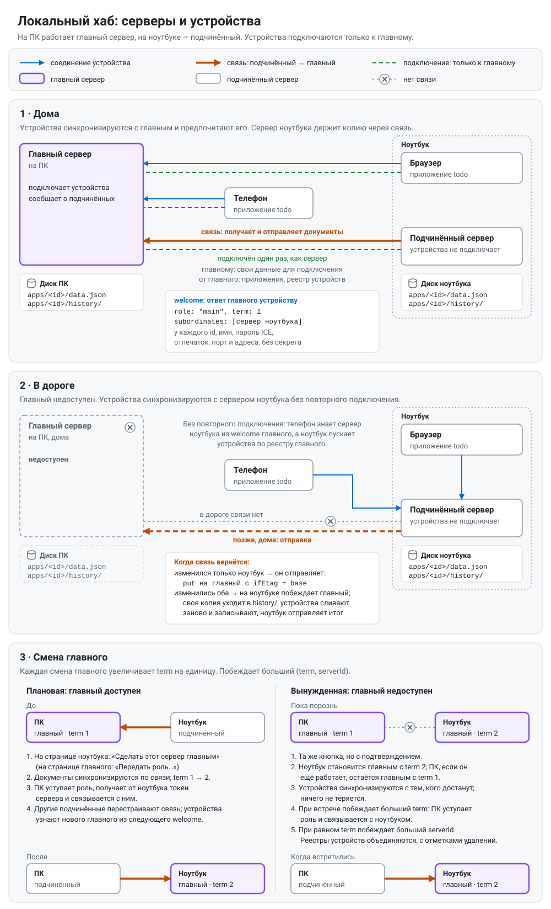

# workspace-server: руководство пользователя

[English version](guide.md)

## Что это

`workspace-server` — небольшая программа, которую вы запускаете на своём компьютере. Данные каждого приложения она хранит одним JSON-файлом в папке на вашем диске. Через неё устройства этого приложения (телефон, ноутбук) синхронизируются друг с другом.

- **Данных приложений она не понимает.** Она хранит то, что прислало приложение, проверяет лишь, что это JSON, а версии различает по хешу. Ни базы данных, ни схемы здесь нет.
- **Работает в вашей локальной сети.** Устройства подключаются к ней по WebRTC. После однократного подключения устройство само соединяется с сервером всякий раз, когда открыто приложение.
- **Сторонние сервисы не нужны.** Нет ни домена, ни сертификата для установки, ни учётной записи, и интернет не требуется.

Первое приложение, которое её использует, — Todo.

## Зачем она нужна

Веб-приложение хранит данные в браузере, а браузер не обещает их сохранить:

- очистка данных сайта их удаляет;
- браузер может вытеснить их, когда мало места;
- Safari удаляет их через семь дней без посещений.

`workspace-server` держит копию на вашем диске — обычный файл, который можно прочитать, сохранить в резервную копию и поправить вручную. Ещё она переносит изменения между устройствами, так что телефон и ноутбук видят одни и те же данные.

## Чем она не является

- **Не источник истины.** Каждое приложение держит свою копию и относится к серверу как к ещё одному участнику — тому, у кого есть диск и кто всегда включён. Приложение работает, когда компьютер выключен или телефон не дома, и потом догоняет изменения.
- **Не делает слияния.** Если два устройства изменили одни и те же данные, приложения разбираются сами. Сервер лишь отклоняет запись, сделанную на основе устаревшей версии.
- **Недоступна снаружи вашей сети,** и учётных записей у неё нет. Она для устройств одного человека в одной локальной сети.

## Что нужно

- Компьютер, который включён, когда нужна синхронизация: macOS, Windows или Linux. На Linux сервер **ни разу не тестировался**, см. [Известные ограничения](#известные-ограничения).
- Устройства в **той же локальной сети**, что и этот компьютер.
- Приложение, которое умеет с ней работать, например Todo.

## Установка

Скачайте файл для своей системы со страницы [GitHub Releases](https://github.com/FLighter7/workspace-server/releases):

| Система | Файл |
| --- | --- |
| macOS, Apple silicon | `wss-mac-arm64` |
| macOS, Intel | `wss-mac-amd64` |
| Windows | `wss-windows-amd64.exe` |
| Linux, x86-64 | `wss-linux-amd64` |
| Linux, ARM64 | `wss-linux-arm64` |

Контрольные суммы — в файле `SHA256SUMS` того же релиза. Программа — один файл. Установщика нет, и больше ничего ставить не нужно.

1. **Выберите постоянную папку** для файла, не «Загрузки»: автозапуск (ниже) запоминает, где лежит файл.
2. **Переименуйте файл** в `workspace-server`, а в Windows — в `workspace-server.exe`. Дальше в руководстве используется это имя.
3. **На macOS и Linux сделайте файл исполняемым.** В терминале, в этой папке (подставьте имя скачанного файла):

   ```
   mv wss-mac-arm64 workspace-server
   chmod +x workspace-server
   ```

### Первый запуск

Файл не подписан цифровой подписью, поэтому система один раз попросит подтверждения:

- **macOS (Gatekeeper):**
  - В macOS 15 и новее: запустите файл один раз и дождитесь блокировки. Затем откройте Системные настройки → Конфиденциальность и безопасность, прокрутите до сообщения о `workspace-server` и нажмите «Всё равно открыть».
  - В более старых macOS: щёлкните по файлу с нажатой Control и выберите «Открыть».
  - В Терминале метку карантина снимает команда `xattr -d com.apple.quarantine workspace-server`.
- **Windows (SmartScreen):** нажмите «Подробнее», затем «Выполнить в любом случае».
- **Брандмауэр** один раз спросит, разрешить ли входящие подключения. Разрешите; в Windows отметьте **частные** сети. Устройства подключаются к серверу, и без этого разрешения они до него не достучатся.
  - В macOS вопрос возвращается после каждого обновления, потому что файл меняется.

## Запуск

**Откройте файл программы:** дважды щёлкните его или выполните `./workspace-server` (macOS, Linux) либо `.\workspace-server.exe` (Windows) в терминале из его папки.

- Откроется окно с журналом сервера, а браузер откроет веб-страницу сервера, по умолчанию `http://localhost:47800/`.
- В macOS двойной щелчок в Finder открывает файл в Терминале.
- **Если сервер уже работает,** второй не запускается: браузер откроет страницу работающего сервера, а вторая программа сразу завершится. В macOS Терминал оставляет её окно открытым с сообщением `workspace-server is already running`; закройте его или в Терминал → Настройки → Профили → Оболочка → «При выходе из оболочки» выберите закрытие окна.
- **Чтобы остановить сервер,** нажмите Ctrl+C в его окне или закройте окно.

При первом запуске сервер создаёт свою папку и запись для приложения `todo`, так что Todo можно подключать сразу.

## Работа в фоне и при входе в систему

```
./workspace-server start      # macOS, Linux
./workspace-server stop
./workspace-server delete
.\workspace-server.exe start  # Windows
```

- **`start`** запускает сервер в фоне, включает его запуск при каждом входе в систему и открывает веб-страницу. Окно не остаётся открытым.
  - Регистрируется LaunchAgent в macOS, задача входа для вашего пользователя в Windows (права администратора не нужны) или служба `systemd --user` в Linux.
  - В Windows программа также появляется в Параметры → Приложения.
  - Если сервер уже работает, `start` перезапускает его, чтобы работал новый файл, который вы только что положили на место.
- **`stop`** останавливает сервер и выключает его запуск при входе. Ничего не удаляется: чтобы снова запустить сервер, выполните `start` или откройте файл.
- **`delete`** удаляет сервер с компьютера, см. «Удаление».
- **Путь к файлу:** `start` запоминает, где лежит файл. Если файл перенести, выполните `start` снова из нового места.
- **В Windows** при входе в систему может на мгновение мелькнуть окно консоли.
- **После сбоя** система запускает сервер снова. После `stop` или кнопки «Остановить сервер» на странице он остаётся остановленным.

## Веб-страница

`http://localhost:47800/` открывается только на этом компьютере, с других устройств её не открыть. Сначала язык — как в браузере (английский, русский или польский), тема — светлая или тёмная, как в системе; две кнопки справа вверху меняют их, и браузер запоминает выбор. В ней три раздела:

- **«Сервер»:**
  - имя, которое видят устройства, адреса компьютера, имя `.local` сервера и опубликовано ли оно, а также два порта; предупреждение под адресами значит, что устройства сейчас не могут подключиться (причина — в `server.log`), а сервер продолжает попытки;
  - имя и порты здесь можно поменять;
  - **«Папка данных»:** где хранятся данные приложений, см. «Где лежат данные»;
  - **«Связь с главным сервером»:** связывает этот сервер с главным, как сервер ноутбука связывают с сервером ПК, см. «Ноутбук как второй сервер»;
  - **«Управление сервером»:** три кнопки, каждая сначала спрашивает:
    - **«Остановить сервер»** останавливает его и выключает запуск при входе, как `stop`. Данные сохраняются.
    - **«Удалить данные»** начинает работу сервера с чистого листа: документы и версии всех приложений, список приложений и подключённые устройства удаляются, и каждое устройство придётся подключить заново. Имя, порты и папка данных сохраняются. В вопросе перечислены данные каждого приложения, и их можно сначала скачать.
    - **«Удалить сервер и все данные»** останавливает сервер и удаляет его с компьютера, как `delete`: данные, его папки, файл программы и автозапуск.
- **«Устройства»:**
  - кнопка **«Подключить устройство»** вверху открывает код подключения; на сервере, связанном с главным, устройства подключают к главному;
  - для каждого приложения — подключённые устройства: когда подключены, когда их видели в последний раз и в сети ли они сейчас; серверы, связанные с этим, показаны первыми, под заголовком **«Связанные серверы»**;
  - кнопка «Удалить» отключает устройство и закрывает ему доступ.
- **«Приложения»:**
  - каждое приложение с размером документа, временем последнего изменения, числом сохранённых версий и числом устройств;
  - здесь приложение добавляют или удаляют вместе с данными и устройствами. При удалении страница показывает, что именно пропадёт, предлагает сначала скачать текущий документ и просит ввести идентификатор приложения.

## Подключение устройства

1. Откройте на веб-странице «Устройства» и нажмите «Подключить устройство». Там будет код подключения — QR-кодом и текстом с кнопкой «Копировать».
2. В приложении на устройстве откройте настройки синхронизации и отсканируйте QR-код или вставьте текст.
3. Устройство подключится. Дальше оно синхронизируется само, когда приложение открыто и сервер доступен.

**О коде:**

- Код действует для **одного устройства** и **10 минут**. «Новый код» создаёт свежий и отменяет старый.
- Кнопки «Подтвердить» нет: раз код у вас, значит, вы были у экрана сервера.
- В коде нет пароля на будущее. Свой ключ доступа устройство получает при подключении, а сервер хранит только его хеш.

Если устройство просит приложение, которого сервер пока не обслуживает, страница предложит добавить его одним нажатием. После этого подключите устройство ещё раз.

## Ноутбук как второй сервер

**Пока недоступно:** синхронизироваться через сервер ноутбука и сами переходить к новому главному устройства начнут только с обновлением приложения, которое ещё не выпущено. Всё, что делают серверы и что описано ниже, работает уже сейчас: связать ноутбук, подключить его браузер, разорвать связь и сделать ноутбук главным.



Главный сервер работает на ПК, а на ноутбуке может работать второй, который хранит копию данных всех приложений на своём диске. Дома устройства синхронизируются с ПК, в дороге — с сервером ноутбука без повторного подключения, а когда ноутбук вернётся домой, серверы обменяются изменениями.

### Настройка ноутбука

1. Установите workspace-server на ноутбук, как на любой компьютер (см. «Установка»), и откройте его страницу.
2. Возьмите код подключения у главного сервера: на странице ПК — **«Устройства»** → **«Подключить устройство»**, или с подключённого к нему телефона (в todo: «Синхронизация» → «Подключить другое устройство»).
3. На странице ноутбука откройте **«Сервер»** и найдите **«Связь с главным сервером»**. Вставьте код и нажмите **«Связать»** или нажмите **«Сканировать камерой»** и поднесите QR-код к камере ноутбука.
4. Сервер ноутбука связан с главным: он берёт приложения главного, копирует их данные и показывает состояние связи.

При связывании ничего не удаляется. Если данные приложения уже есть на обоих серверах, на ноутбуке побеждает копия главного, копия ноутбука остаётся среди сохранённых версий, а устройства объединят обе. Сервер, с которым связаны другие серверы, нельзя связать с другим главным.

### Подключение браузера ноутбука

Устройства подключаются только к главному, и собственный браузер ноутбука тоже. На странице ноутбука нажмите **«Подключить браузер этого компьютера»** (в разделе «Устройства» или в «Сервер» → «Связь с главным сервером»). Ноутбук попросит у главного код подключения и покажет его QR-кодом и текстом с кнопкой «Копировать»; вставьте его в настройки синхронизации приложения в браузере. Для этого главный должен быть доступен. Как и с любым новым кодом, код на странице главного перестаёт действовать.

### Дома и в дороге

- **Дома** устройства синхронизируются с главным, а сервер ноутбука держит свою копию в согласии с главным.
- **В дороге**, когда главный недоступен, устройства, подключённые к главному, синхронизируются с сервером ноутбука без повторного подключения: главный сообщил им о нём. Ноутбук сохраняет изменения.
- **Дома снова** ноутбук отправляет главному то, что изменилось. Если изменились обе стороны, на ноутбуке побеждает копия главного, копия ноутбука уходит в сохранённые версии, а устройства объединяют обе, как всегда.
- Устройство, подключённое, пока ноутбук не мог связаться с главным, начнёт синхронизироваться с ноутбуком только после того, как они снова встретятся.

### Как за этим следить

- В разделе **«Связь с главным сервером»** на ноутбуке видны главный сервер, есть ли соединение, когда связан, последняя синхронизация и синхронизируемые приложения. Если приложение пишет на главный слишком часто в течение минуты, его синхронизация с главным останавливается, чтобы сохранить версии на обоих серверах; раздел показывает такое приложение, а его устройства продолжают синхронизироваться с ноутбуком. Нажмите **«Возобновить»** рядом с ним, чтобы сразу снова синхронизировать его с главным; перезапуск сервера ноутбука тоже её возобновляет. Если приложение и дальше пишет так часто, синхронизация снова остановится.
- В разделе **«Устройства»** главного сервер ноутбука показан под заголовком **«Связанные серверы»**, с его адресами. Кнопка **«Удалить»** там прекращает его синхронизацию с главным; данные остаются на ноутбуке.
- Кнопка **«Разорвать связь»** на странице ноутбука снова делает его главным. Ни на одной стороне ничего не удаляется, а устройства главного больше не синхронизируются через ноутбук. Если главный в этот момент недоступен, страница скажет об этом: удалите ноутбук на странице главного позже.

### Как сделать ноутбук главным

Сервер ноутбука может взять на себя роль главного: когда ноутбук становится вашим основным компьютером или когда ПК сломался. Тогда устройства подключаются к ноутбуку, а сервер ПК, если он ещё есть, синхронизируется через ноутбук, как раньше ноутбук через ПК. Ни одно устройство не подключается заново, и ничего не удаляется.

- **Пока ПК доступен:** на странице ноутбука откройте **«Сервер»** → **«Связь с главным сервером»** и нажмите **«Сделать этот сервер главным»** или на странице ПК откройте **«Устройства»** → **«Связанные серверы»** и нажмите **«Сделать главным»** на карточке ноутбука. Подтвердите. Сначала два сервера выравнивают данные, затем сервер ПК передаёт роль и связывается с сервером ноутбука; другие серверы, связанные с ПК, перейдут сами.
- **Когда ПК недоступен** (выключен, далеко, сломан): нажмите **«Сделать этот сервер главным»** на странице ноутбука. Страница переспросит и скажет, что будет дальше:
  - сервер ноутбука сразу становится главным;
  - если сервер ПК ещё работает, оба будут главными, пока снова не встретятся; устройства синхронизируются с тем, до которого дотянутся, и ничего не теряется;
  - когда они встретятся, побеждает тот, кого сделали главным позже: сервер ПК сам уступит роль и будет синхронизироваться через сервер ноутбука, а его собственные изменения объединят устройства.
- **Если ПК больше нет,** страница ноутбука показывает его среди серверов, которых ждёт. Когда станет ясно, что он не вернётся, удалите его в разделе **«Устройства»** на странице ноутбука.
- **Устройства** работают всё это время: устройство, подключённое к ПК, находит сервер ноутбука главным и дальше считает его своим сервером.

## Обновление

1. Положите новый файл на место старого, с тем же именем и в ту же папку. В Windows сначала выполните `stop`: работающий файл программы там не заменить.
2. Выполните `start`. Он перезапустит сервер на новом файле.

Данные, настройки и подключения сохраняются, и переподключать устройства не нужно. В macOS снова подтвердите вопросы Gatekeeper и брандмауэра.

## Удаление

Выполните `delete`, нажмите на веб-странице **«Удалить сервер и все данные»** или, в Windows, удалите «workspace-server» в Параметры → Приложения.

- Сначала показывается, что пропадёт, включая путь к файлу программы, и задаётся вопрос `Delete all of this? [y/N]`. Удаляет только `y`; Enter оставляет всё как есть.
- Сервер останавливается, его запуск при входе выключается, удаляются папка сервера, данные приложений и файл программы.
- Если вы выбрали свою папку данных, в ней удаляются только данные сервера. Сама папка удаляется, только если в ней больше ничего не осталось.
- **Пропадёт копия данных всех приложений на сервере и все подключения устройств.**
  - Свои копии устройства сохранят; выключите синхронизацию в каждом приложении.
  - Если документ нужен, сначала скачайте его в разделе «Приложения».
- `delete --yes` удаляет без вопроса.
- **Что остаётся:**
  - Записи брандмауэра. Windows оставляет правило, созданное при первом запуске; удалить его можно только с правами администратора: Безопасность Windows → Брандмауэр и защита сети → Разрешить работу с приложением через брандмауэр. В macOS запись находится в Системные настройки → Сеть → Брандмауэр → Параметры.
  - В Windows, если удалить файл программы вручную, его запись в Параметры → Приложения останется. Windows её не убирает.

## Где лежат данные

Настройки и «личность» сервер хранит в своей **папке сервера**:

| Система | Папка сервера |
| --- | --- |
| macOS | `~/Library/Application Support/workspace-server` |
| Windows | `%APPDATA%\workspace-server` |
| Linux | `$XDG_DATA_HOME/workspace-server`, по умолчанию `~/.local/share/workspace-server` |

```
config.json            имя, порты и папка данных
identity.json          «личность» сервера; если файл потерян, все устройства подключаются заново
apps.json              приложения, которые обслуживает сервер
devices.json           подключённые устройства
upstream.json          связь с главным сервером, на сервере, связанном с главным
family.json            на сервере, который взял на себя роль главного
server.log             журнал; он никогда не больше 1 МиБ
server.lock            не даёт второму серверу работать с этой папкой
```

Данные приложений лежат в **папке данных** — это папка сервера, если вы не выбрали другую:

```
apps/<id>/data.json    текущие данные приложения
apps/<id>/history/     предыдущие версии (по умолчанию 10)
```

- **Выбор папки данных:** на веб-странице в разделе «Сервер» → «Папка данных» введите или вставьте путь к папке и нажмите «Изменить».
  - Если папки ещё нет, она будет создана.
  - Если данные уже есть, страница предупредит, что они будут перенесены туда, и сервер перезапустится. Устройства остаются подключёнными.
  - Если в новой папке уже есть данные сервера, а в текущей нет, страница предложит использовать те данные и добавит их приложения в список.
  - Если данные есть в обеих папках, смена отклоняется.
  - Если папка на диске, который не подключён в момент запуска сервера, сервер не запустится. Причина будет в `server.log` в папке сервера.
- **Данные каждого приложения** хранятся ровно так, как их прислало приложение, обычным JSON-файлом.
  - Прежде чем изменение их заменит, старая версия переезжает в `history/`.
  - Наибольший принимаемый документ по умолчанию — 64 МиБ, для каждого приложения это можно поменять.
- **Запись атомарная:** сбой или отключение питания оставляют либо старый файл, либо новый, но никогда не половину.
- **`apps.json`** можно править вручную, пока сервер работает. Правка вступает в силу за несколько секунд.
- **Резервная копия и переезд:** для резервной копии скопируйте папки. Чтобы перенести сервер на другой компьютер, скопируйте туда папку сервера (и папку данных, если она другая) — все подключения продолжат работать. Выбранная папка данных запоминается по полному пути: на новом компьютере положите её по тому же пути до запуска сервера. Если её там нет, сервер либо не запустится, либо запустится без данных.
- **Одна папка — один сервер:** два сервера не могут одновременно работать с одной папкой сервера.

Чтобы запустить второй, отдельный сервер или сервер на других портах на один запуск:

```
./workspace-server run -dir <папка> -udp-port <n> -http-port <n>
```

`stop -dir <папка>` и `delete -dir <папка>` действуют только на такой сервер и не трогают автозапуск и файл программы.

## Порты и сеть

- **UDP 47801** — для устройств, они подключаются сюда.
  - Если его поменять, **все устройства придётся подключить заново**, потому что они его запоминают. Страница предупреждает об этом.
- **HTTP 47800** — для веб-страницы, только на этом компьютере.
  - Его можно менять свободно, страница переедет на новый порт.
- **Смена адресов подхватывается сама.** Сервер проверяет адреса компьютера каждые 30 секунд. При смене устройства переподключаются сами.
- **VPN:** VPN на компьютере не мешает устройствам в локальной сети.

## Если что-то не работает

- **Устройство не подключается:**
  - Проверьте, что устройство и компьютер в одной сети. Гостевая сеть с «изоляцией клиентов» не пускает устройства друг к другу.
  - Проверьте, что брандмауэр разрешает `workspace-server` (в Windows — для **частных** сетей).
  - Проверьте, что сервер работает: веб-страница открывается.
  - В `server.log` в папке сервера написано, на каких адресах слушает сервер.
- **«another workspace-server is already using …»:** с этой папкой уже работает сервер, но не на порту из его настроек. Остановите его или откройте его страницу на том порту, который вы ему дали.
- **Окно сразу закрывается:** скорее всего, сервер уже работает и его страница открылась в браузере. Иначе запустите файл из терминала, чтобы увидеть сообщение.
- **Код подключения истёк:** нажмите «Новый код».
- **Приложение пишет, что сервер его не знает:** окно «Подключить устройство» предложит добавить приложение. Добавьте и подключите устройство ещё раз.
- **Веб-страница не открывается:** проверьте, что сервер работает. Если меняли HTTP-порт, используйте новый. Адрес страницы указан в `server.log`.

## Известные ограничения

- **Область работы:** только локальная сеть и IPv4. Учётных записей нет, один документ на приложение.
- **Windows:** поиск сервера по имени `.local` занимает около секунды, но у устройств есть и его IP-адреса.
- **Windows, фоновый режим:** у сервера, запущенного через `start` или при входе в систему, нет окна консоли. Поэтому закрытие окна его больше не останавливает: используйте кнопку «Остановить сервер» на веб-странице или `stop`.
- **Проверено на сегодня:**
  - сервер и его имя `.local` на macOS;
  - на macOS: открытие файла (двойной щелчок в Finder, повторный двойной щелчок, закрытие окна Терминала), `start`, `stop`, `delete`, три кнопки управления сервером на странице и смена папки данных;
  - на Windows 10 под обычным пользователем: открытие файла (повторный запуск открывает страницу работающего сервера, закрытие окна останавливает его), `start`, `stop`, `delete` (включая файл программы, даже в папке с кавычками и пробелами в имени), кнопки управления сервером на странице, смена папки данных, ограничение размера журнала и фоновый режим без окна консоли (всё — из командной строки и по адресу страницы, без человека у экрана);
  - сервер и блокировка папки на Windows 10 под обычным пользователем;
  - на Windows 10 человеком у экрана: запись в Параметры → Приложения и её кнопка «Удалить», а также запуск при входе в систему (окно консоли не мелькнуло);
  - клиенты: Safari и Chrome на iPhone, Chrome на Mac.
- **Linux: не тестировалось.** Файлы для Linux собираются из того же кода, но на Linux-машине сервер никто не запускал, и проверить его там не на чем. Возможно, он работает, но это ничем не подтверждено.
- **Пока не проверялось:** клиенты Safari на Mac и Android.
- **Ноутбук как второй сервер** пока проверен только с обоими серверами на одном компьютере с Windows. Ещё не проверялось: ПК и ноутбук как два компьютера, Mac в роли ноутбука, его страница в Safari, сканирование кода настоящей камерой и телефоны, синхронизирующиеся через сервер ноутбука.
- **В дороге** две вещи могут не пустить устройство к серверу ноутбука, и ни одна ещё не проверялась:
  - совсем без сети (Wi-Fi выключен) собственный браузер ноутбука может не достучаться до сервера на том же ноутбуке; приложение при этом работает само и синхронизируется, когда сеть вернётся;
  - в Wi-Fi гостиницы или кафе, которая не пускает устройства друг к другу, а возможно, и в точке доступа вашего телефона телефон может не найти ноутбук.
- **Docker:** образ Docker для NAS — следующий шаг.

## Сборка из исходников

Нужны Go 1.27, а для веб-страницы, которую программа носит в себе, — Node.js и pnpm.

```
node scripts/build.mjs
```

Команда собирает страницу, затем программу для всех систем — в `dist/`: те же файлы, что в релизе, вместе с `SHA256SUMS`. Тесты:

```
go test -race ./...
```

Программа, собранная простым `go build` без страницы, работает, но её страница только подсказывает, как её собрать.

Как всё устроено внутри, почему сделано именно так и как выпускаются релизы — в [architecture.md](architecture.md) (на английском).
